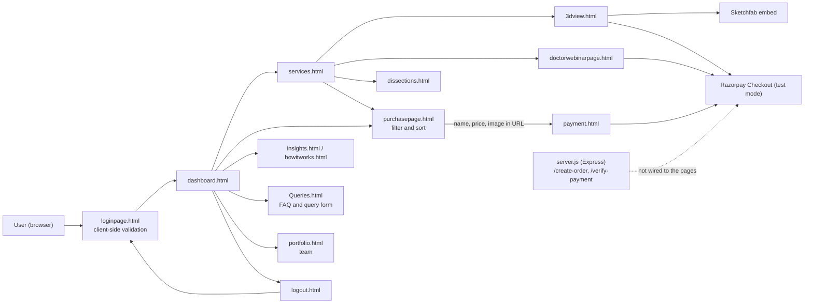

# Anatomy Hub (Team CODEHOLICS)

A static, multi-page website prototype for learning human anatomy through embedded 3D models, skull and brain descriptions, doctor consultation booking and an anatomy product shop with Razorpay test payments.

## Overview

### Problem statement

In today's rapidly advancing healthcare landscape, understanding human anatomy is crucial for both students and professionals in the medical field. Traditional methods of learning anatomy, such as textbooks and static images, often fail to provide an interactive, engaging, and detailed learning experience. Additionally, accessing expert advice for medical inquiries can be challenging due to geographical and financial constraints.

### What this project does

Anatomy Hub is a front-end prototype built by Team CODEHOLICS that brings these needs into a single website:

- interactive 3D anatomy (an embedded Sketchfab model of head anatomy and musculature),
- written explanations of the brain and skull that appear when you click an image,
- a page to book sessions with doctors (free short trial or paid one-hour session),
- a shop for anatomy models, books and charts with a checkout that opens Razorpay in test mode,
- an FAQ and query form.

It is plain HTML, CSS and JavaScript that runs in the browser. There is no database and no real user accounts; all form handling, booking and filtering happens client-side. The doctor profiles and shop items are sample content.

## Key features

| Feature | Page(s) | Status |
| --- | --- | --- |
| Login form with client-side validation (email format, age 18+, username with an uppercase letter, password of 8+ characters) and a 3D tilt effect that follows the mouse | [loginpage.html](loginpage.html), [loginpagejs.js](loginpagejs.js) | Prototype: validation only, no authentication backend |
| Dashboard with navigation to every section | [dashboard.html](dashboard.html) | Working |
| Services overview | [services.html](services.html) | Working |
| 3D head anatomy model (Sketchfab embed) plus a locked "premium" panel that opens a Razorpay test checkout | [3dview.html](3dview.html) | Working (needs internet); payment does not unlock anything |
| Skull and brain dissection descriptions: click one of three images and the description is typed out | [dissections.html](dissections.html), [dissectionjs.js](dissectionjs.js) | Working |
| Doctor consultation booking: 10 sample doctors, a free short session with a time-slot picker (one per page visit) and a paid one-hour session via Razorpay | [doctorwebinarpage.html](doctorwebinarpage.html), [new.html](new.html) | Prototype: bookings are not stored or emailed |
| Anatomy shop: filter by category (organ models, books, charts), sort by name or price, "Buy Now" passes the item to the payment page | [purchasepage.html](purchasepage.html), [purchasepage2.js](purchasepage2.js) | Working |
| Payment page: reads the product from the URL, validates name, address and 6-digit pincode, then opens Razorpay Checkout in INR | [payment.html](payment.html) | Test mode only |
| Insights and "How it works" content pages | [insights.html](insights.html), [howitworks.html](howitworks.html) | Static content |
| FAQ and query submission form | [Queries.html](Queries.html), [queriesjs.js](queriesjs.js) | Client-side only; queries are not sent anywhere |
| Team page | [portfolio.html](portfolio.html) | Working |
| Express server with Razorpay order-creation and signature-verification endpoints | [server.js](server.js) | Standalone sample, not called by any page |

## Architecture



- **Pages**: each HTML file is a self-contained page with its own inline or linked CSS and JavaScript. Navigation is through ordinary links.
- **Client-side scripts**: form validation, the dissection typing effect, shop filtering and sorting, and the logout redirect.
- **Third-party services**: Sketchfab (3D model iframe), Razorpay Checkout (`checkout.js`, loaded from Razorpay's CDN) and external image URLs for many products and backgrounds.
- **server.js**: an Express sample showing how a Razorpay order would be created on a server and how a payment signature would be verified. The front end currently calls Razorpay Checkout directly and never calls this server.

## How it works

1. The user opens `loginpage.html` and fills in the form. If every field passes validation, a "Go to Dashboard" link appears.
2. The dashboard links to services, products, insights, help (queries), the team page and logout.
3. From Services the user can:
   - open the 3D view, rotate the Sketchfab model and click the lock icon to start a Razorpay test payment for "premium" access;
   - open the doctor consultation page, pick a doctor and either book a free short session (choose a time slot, then confirm) or pay for a one-hour session through Razorpay;
   - open the dissections page and click an image to read about the left brain and skull and related structures.
4. In the shop the user filters and sorts products and clicks "Buy Now". The product name, price and image are passed in the query string to `payment.html`, which validates the shipping form and opens Razorpay Checkout for that amount.
5. `logout.html` clears a stored token and redirects back to the login page after one second.

## Tech stack

| Layer | Technologies |
| --- | --- |
| Front end | HTML5, CSS3, vanilla JavaScript |
| 3D content | Sketchfab embedded viewer |
| Payments | Razorpay Checkout (test mode); `razorpay` Node SDK in [server.js](server.js) |
| Sample back end | Node.js, Express, body-parser, `crypto` (HMAC-SHA256) |
| Assets | Local images and video, Google Fonts, Font Awesome |

## Project structure

```
CODEHOLICS/
├── loginpage.html / loginpagejs.js / stylesloginpage.css   # Login form and validation (start here)
├── dashboard.html / styleproj2.css                         # Home dashboard and navigation
├── services.html / servicepage.css                         # Services overview
├── 3dview.html                                             # Sketchfab 3D model and premium unlock
├── dissections.html / dissectionjs.js / dissection.css     # Brain and skull descriptions
├── doctorwebinarpage.html                                  # Doctor consultation booking
├── new.html                                                # Earlier two-doctor draft of the webinar page (not linked)
├── purchasepage.html / purchasepage2.js / purchase.css     # Anatomy product shop
├── payment.html                                            # Checkout form and Razorpay payment
├── insights.html / howitworks.html                         # Content pages
├── Queries.html / queriesjs.js                             # FAQ and query form
├── portfolio.html / portfoliostyles.css                    # Team page
├── logout.html / logoutpage.js                             # Logout and redirect
├── server.js                                               # Express + Razorpay sample server (standalone)
├── package.json                                            # Node dependency list (razorpay)
├── node_modules/                                           # Committed dependencies (Razorpay SDK and its deps)
└── *.jpg / *.png / *.avif / anatomyvideo.jpg.mp4           # Images and video used by the pages
```

## Getting started

### Prerequisites

- A modern web browser and an internet connection (the 3D model, Razorpay Checkout and many images load from external sites).
- Optional: Python 3 or any static file server, to serve the pages over HTTP.
- Optional, only for `server.js`: Node.js and npm.

### Run the website

Clone the repository and open the login page:

```bash
git clone https://github.com/suriyaprakash-25/CODEHOLICS.git
cd CODEHOLICS
```

Then either open `loginpage.html` directly in your browser, or serve the folder and visit `http://localhost:8000/loginpage.html`:

```bash
python -m http.server 8000
```

Payments run in Razorpay test mode, so no real money is charged. Use Razorpay's published test card details to complete a test payment.

### Run the sample payment server (optional)

`server.js` requires `express` and `body-parser`, which are not listed in `package.json`, so install them alongside the existing dependency:

```bash
npm install
npm install express body-parser
node server.js
```

The server listens on `http://localhost:3000` and exposes:

| Method | Endpoint | Body | Purpose |
| --- | --- | --- | --- |
| POST | `/create-order` | `{ "amount": 499, "currency": "INR" }` | Creates a Razorpay order (amount is converted to paise) |
| POST | `/verify-payment` | `{ "razorpay_order_id", "razorpay_payment_id", "razorpay_signature" }` | Checks the HMAC-SHA256 payment signature |

Razorpay credentials should be supplied through configuration (for example `RAZORPAY_KEY_ID` and `RAZORPAY_KEY_SECRET` environment variables) rather than written in the source; the current file has them inline and the verification step still uses a placeholder secret.

### Tests

There are no automated tests (`npm test` is the default placeholder).

## Limitations and roadmap

- **No real authentication.** The login form only validates input; no token is created. The dashboard checks `sessionStorage` for a token while logout clears `localStorage`, so the session logic is incomplete.
- **No persistence.** Bookings, queries and purchases are not stored or sent anywhere; confirmations are browser alerts or on-page messages.
- **Payments are test mode and not verified.** Razorpay Checkout is opened directly from the browser; [server.js](server.js) is not connected, and the "premium" 3D unlock does not change access after payment.
- **Sample content.** Doctor profiles, shop prices and the dashboard statistics are placeholder content, not real data.
- **Loose ends**: `dissections.html` also references a `script.js` that is not in the repository, `insights.html` links a missing `styles.css`, and the `CODEHOLICS/` entry is an empty submodule reference with no `.gitmodules` file.
- **Future idea (from the project's "How it works" page):** an app that analyses a person's medical reports with AI and gives personalised suggestions. This is not implemented.

## Team

Team CODEHOLICS:

- [Yugendra N](https://github.com/Yugenjr) - Full-stack developer
- [Suriyaprakash R M](https://github.com/suriyaprakash-25) - Full-stack developer
- [Suvetha S](https://github.com/suvethasenthil1) - UI/UX design
- [Sureka K](https://github.com/surekakandasamy) - Code editing

Built by [Suriyaprakash](https://github.com/suriyaprakash-25) with Team CODEHOLICS.
